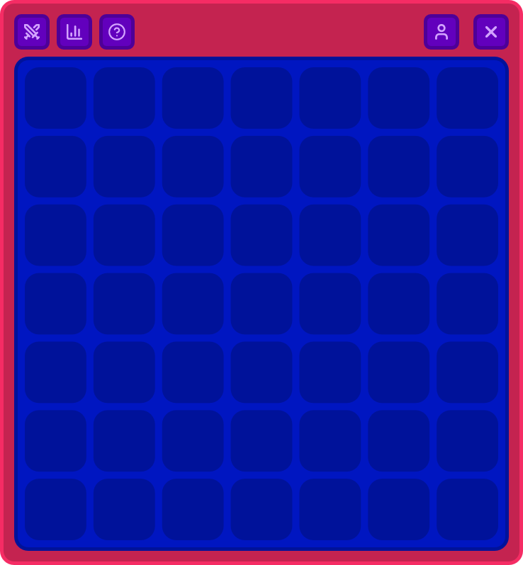
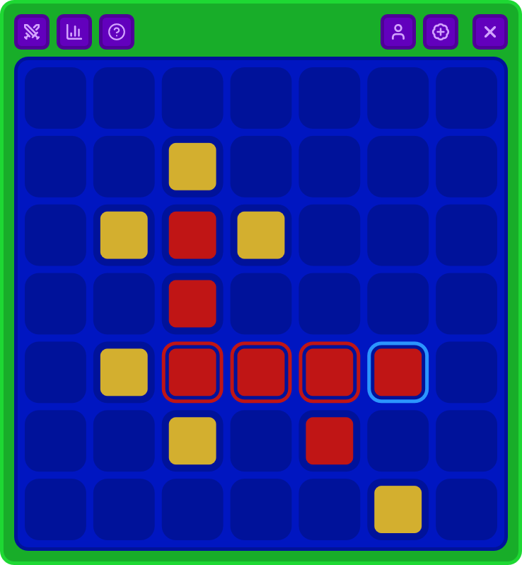
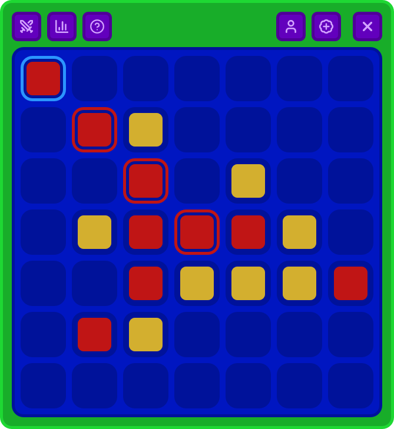
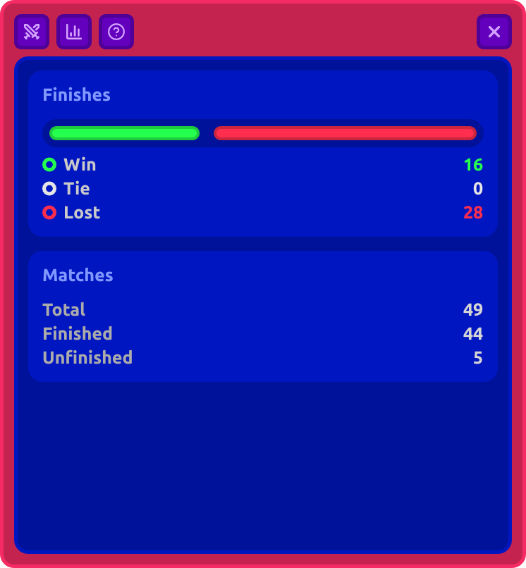
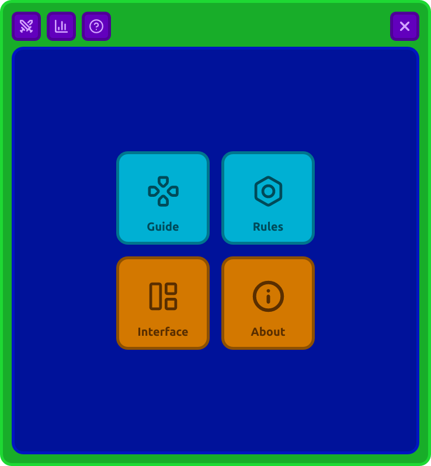
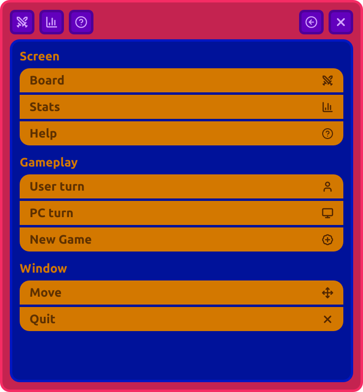
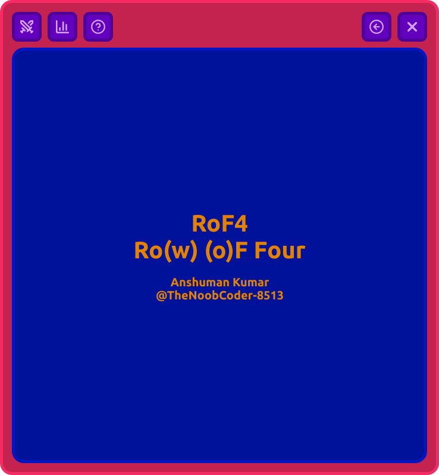

<div align="center">

# RoF4
## Row of Four

**A sleek, tactical 7×7 Connect-Four game engineered in Rust with a declarative Slint GUI and intelligent Minimax AI.**


[Features](#-features) • [Screenshots](#-visual-showcase) • [Architecture](#-architecture--system-design) • [AI Engine](#-ai-decision-engine) • [Getting Started](#-getting-started) • [Controls](#-controls--navigation)

</div>

---

## Overview

**RoF4** (*Ro(w) (o)F Four*) reimagines the classic four-in-a-row tactical puzzle as a high-performance native desktop application. 

Built with **Rust** and styled declaratively with **Slint**, RoF4 pairs a frameless modern visual design with sound game state modeling, compile-time win evaluation, and an AI opponent.

Whether practicing strategic openings, analyzing match metrics, or facing off against the computer's minimax engine, RoF4 provides a responsive, local-first gaming experience.

---

## Features

- **Tactical 7×7 Grid Matrix**: Expansive 49-cell board featuring 88 compile-time pre-computed winning paths across horizontal, vertical, and both diagonal vectors.
- **Intelligent Minimax AI**:
  - Instant win recognition and immediate opponent threat blocking.
  - Proximity candidate pruning focused around active clusters and center control.
  - Depth-2 Alpha-Beta minimax search evaluating streak potential and positional advantage.
  - Natural 300ms reaction pacing to simulate human play without UI freezes.
- **Modern Frameless Slint Interface**:
  - Borderless window geometry with customizable rounded corners and reactive accent outlines.
  - Dynamic game state border cues: Crimson (`#c42350`) during active play, Emerald (`#18ad29`) on victory.
  - Interactive cell hover previews, blue highlight borders for the most recent move, and glowing rings along winning streaks.
  - Integrated titlebar with custom window dragging (`WindowMoveArea`), quick reset, turn indicator, and smooth screen switcher.
- **Persistent Match Analytics**:
  - Automatically records match outcomes (`Win`, `Lost`, `Tie`, `Unfinished`), move counts, and timestamps to `data/history.json`.
  - Proportional visual progress charts illustrating Win/Tie/Loss ratios.
  - FIFO rolling match ledger keeping detailed records of the last 20 encounters.
- ℹ**Interactive Help & About Hub**:
  - Modular in-app documentation detailing interface icons, turn dynamics, and gameplay controls.
  - Integrated project and author showcase.

---

## Visual Showcase

### Game Board & Match States








### Analytics & System Screens










### Module Breakdown

| Module | Responsibility |
| :--- | :--- |
| [`src/main.rs`](file:///Drive/Playground/Public/RowOf4/src/main.rs) | Application entry point; initializes Slint event loop and connects `GameController`. |
| [`src/game.rs`](file:///Drive/Playground/Public/RowOf4/src/game.rs) | Core rules engine; 7×7 board representation, turn tracking, move validation, and 88 compile-time winning lines (`generate_winning_lines()`). |
| [`src/ai.rs`](file:///Drive/Playground/Public/RowOf4/src/ai.rs) | Intelligent CPU opponent; immediate win/block detection, proximity candidate filtering, and depth-2 Alpha-Beta Minimax search. |
| [`src/controller.rs`](file:///Drive/Playground/Public/RowOf4/src/controller.rs) | UI-to-engine bridge; synchronizes 2D `VecModel<TSlot>` models, manages turn timers, handles win/loss triggers, and updates match analytics. |
| [`src/history.rs`](file:///Drive/Playground/Public/RowOf4/src/history.rs) | Local JSON ledger; tracks match history with FIFO eviction (20 matches) and cumulative statistics persistence. |
| [`ui/`](file:///Drive/Playground/Public/RowOf4/ui/) | Slint declarative design files (components, layouts, state globals, theme tokens, and dialogs). |

---

## Getting Started

### Prerequisites

Ensure you have the Rust toolchain installed (Rust 1.85+ recommended for 2024 edition support):

```bash
curl --proto '=https' --tlsv1.2 -sSf https://sh.rustup.rs | sh
```

For Linux environments, ensure standard GUI rendering dependencies are present:

```bash
# Ubuntu / Debian
sudo apt update
sudo apt install libfontconfig1-dev libfreetype6-dev libxkbcommon-dev libxkbcommon-x11-dev libgl1-mesa-dev
```

### Installation & Run

1. **Clone the repository:**
   ```bash
   git clone https://github.com/TheNoobCoder-8513/RowOf4.git
   cd RowOf4
   ```

2. **Run the game in release mode:**
   ```bash
   cargo run --release
   ```

3. **Execute automated test suites:**
   ```bash
   cargo test
   ```
   *The test suite verifies win conditions (horizontal, vertical, both diagonals), occupied cell guards, AI immediate win/block decisions, and FIFO match history persistence.*

---

## Project Structure

```
RowOf4/
├── Cargo.toml            # Rust package manifest & dependencies
├── build.rs              # Slint UI build script
├── data/
│   └── history.json      # Persistent match history ledger

├── src/
│   ├── main.rs           # App entry & runtime setup
│   ├── controller.rs     # Controller & UI-engine synchronization
│   ├── game.rs           # Rules engine, grid, & 88 winning vectors
│   ├── ai.rs             # Heuristic Minimax decision engine
│   └── history.rs        # Match history persistence & FIFO ring
└── ui/
    ├── app.slint         # Root application window & popup dialogs
    ├── model.slint       # Shared Slint structs & enums
    ├── state.slint       # Global reactive UI state
    ├── theme.slint       # Color tokens & theme definition
    ├── assets/icons/     # Vector SVG interface icons
    ├── dialogs/          # Confirmation and completion modals
    ├── lego/             # Reusable UI widgets (Cell, Menu, Buttons)
    └── screens/          # Primary view screens (Board, Stats, Info)
```

---
